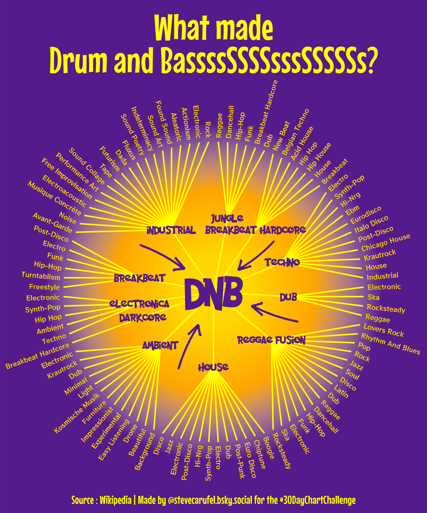

# what-made-drum-and-bass
Circular chart showing which genres lead to the main genres that made drum and bass #dnb

Must be read from the outer ring to the center. Some music genres are present more that once on the outer ring as they might have given birth to several younger genres which, in turn, lead to DNB. Only the arrows were added outside R. Discussion on the methodology below the chart.

# Where does the data come from?

The data comes from Wikipedia. Usually, a given genre's article has convenient data in its infobox, one of which is "Stylistic Origins".

