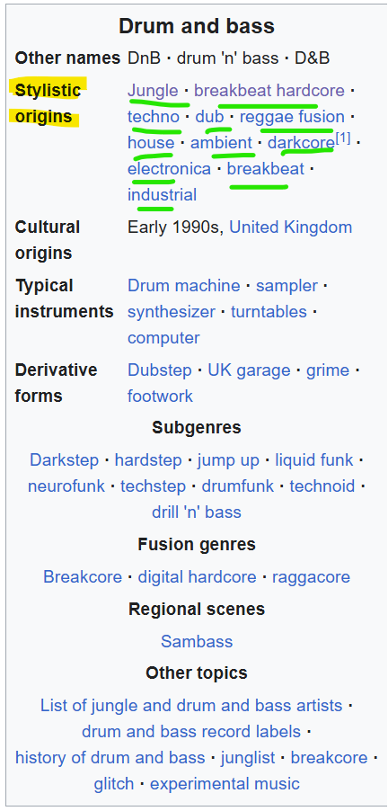
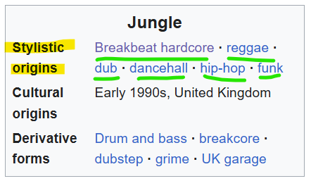

# what-made-drum-and-bass
Circular chart showing which genres lead to the main genres that made drum and bass #dnb

Must be read from the outer ring to the center. Some music genres are present more that once on the outer ring as they might have given birth to several younger genres which, in turn, lead to DNB. And, actually, some are on two levels, like Dub.

Arrows were added outside R. Discussion on the methodology below the chart.

# Where does the data come from?

The data comes from Wikipedia with a fairly simple web scraper. Usually, a given genre's article has convenient data in its infobox, one of which is "Stylistic Origins".

Here's the one found on the Drum and Bass <a href="https://en.wikipedia.org/wiki/Drum_and_bass" target="_blank" rel="noopener noreferrer">article</a> :

So from there, I scraped the stylistic origins (jungle, dub, etc) along with their hyperlink to their own wiki article. After which, for each of them, I do the same thing, scraping this parent genre's own stylistic origins. 

Example from the Jungle <a href="https://en.wikipedia.org/wiki/Jungle_music" target="_blank" rel="noopener noreferrer">article</a>, which is one level below DNB :

